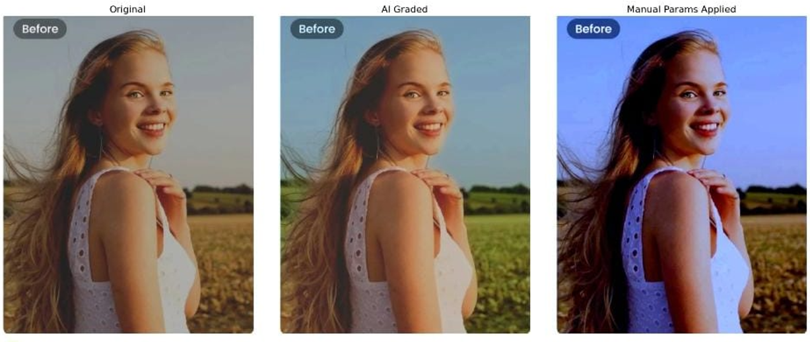
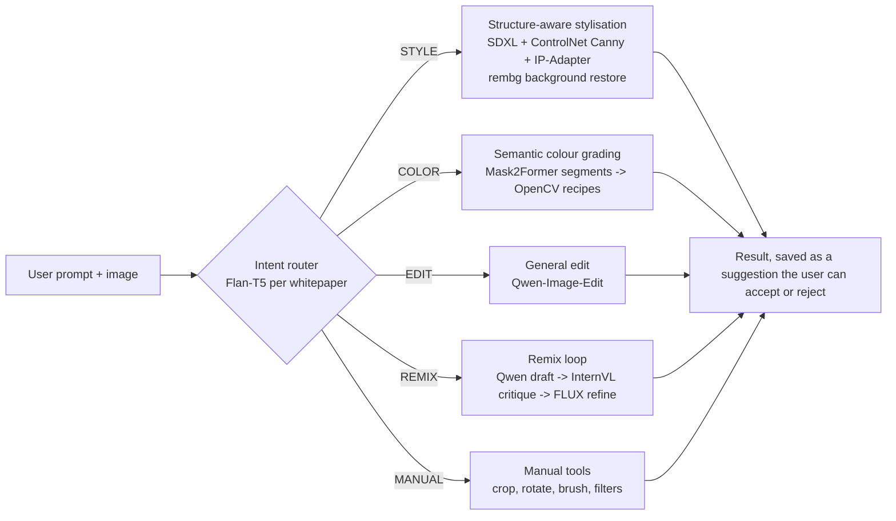
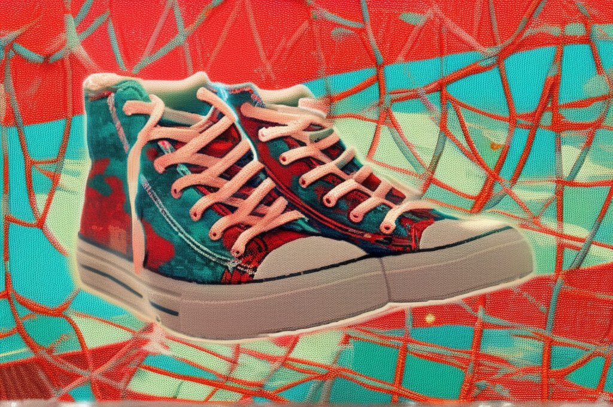
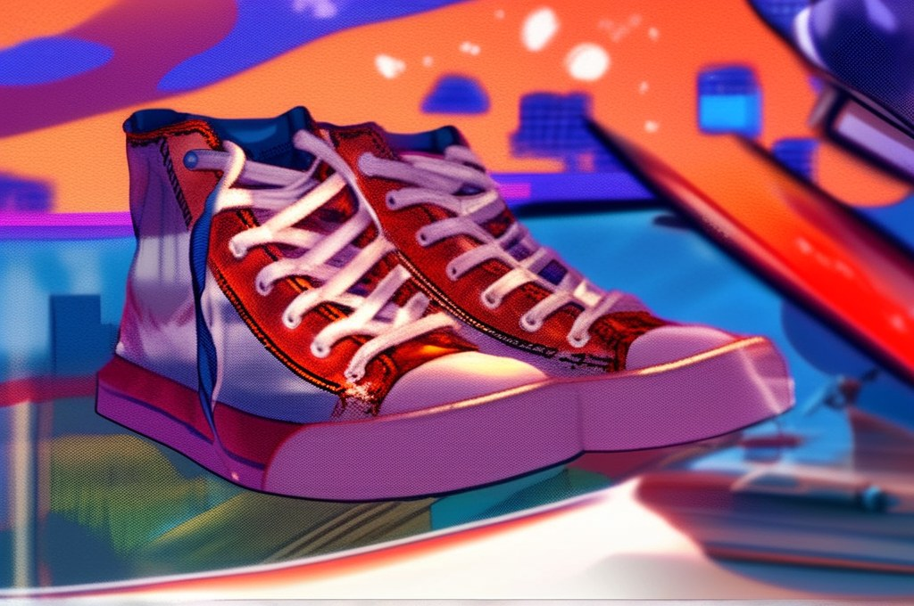
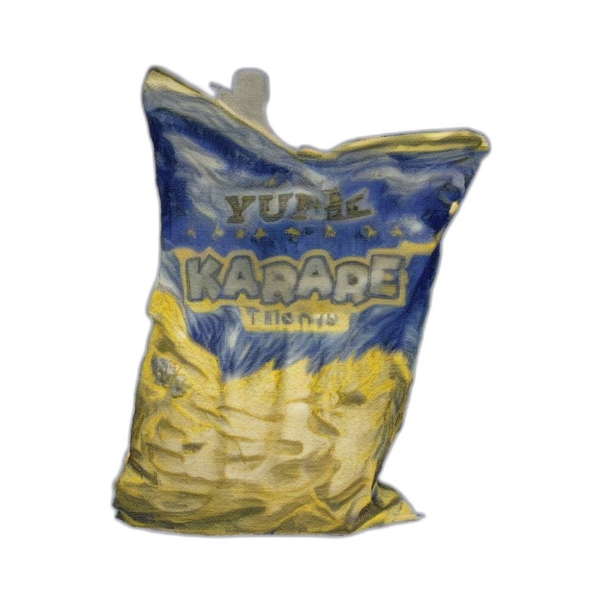
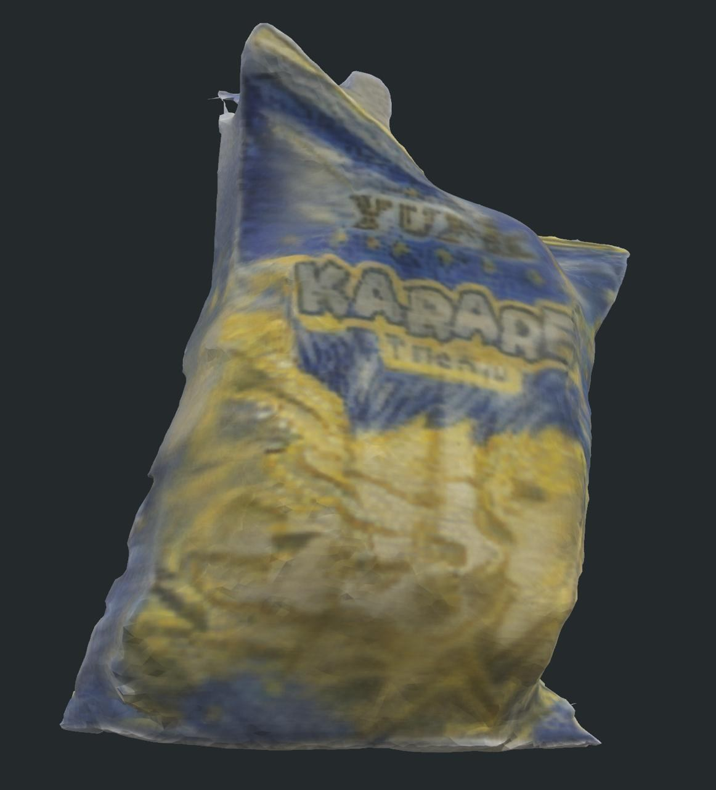

# Canvas360: an intent-based, AI-native image editor


Canvas360 is a team project from **Inter-IIT Tech Meet 14.0** (Adobe problem
statement, "Re-imagining Photoshop for the Creative Cloud future"). It proposes
moving image editing from pixel tools toward *intent*: the user says what they
want, and a router sends the request to a small, specialised pipeline.

This repository holds the team's own code, a few prototype scripts, the
measurements that exist in the project folder, and curated result images. It is
a design-plus-prototype showcase, not a shipped product.



## Paper

A two-page research-style write-up of the project is in [`paper/canvas360.pdf`](paper/canvas360.pdf)
(LaTeX source: [`paper/canvas360.tex`](paper/canvas360.tex), references in [`paper/references.bib`](paper/references.bib)).

## Contents

- [Paper](#paper)
- [Problem](#problem)
- [Approach](#approach)
- [Results](#results)
- [Quick start](#quick-start)
- [Tech stack](#tech-stack)
- [Learnings and limitations](#learnings-and-limitations)
- [Repository layout](#repository-layout)
- [References and licences](#references-and-licences)
- [License](#license)

## Problem

Phone-first creators want professional-level edits, but desktop tools are dense
and generative AI editors are unreliable on the edits people care about most.
The team's reading of the brief was that AI editors fail mainly on:

- **Identity preservation**: edits such as a shirt colour change alter the subject.
- **Unrequested changes**: smoothing skin or changing lighting that the user did not ask for.
- **Compositing**: merging subjects into a new scene leaves floating subjects and mismatched light.

The brief was split into three tasks: product design, ecosystem and market
context, and execution and engineering. This repository covers the third task
and the prototype parts of the first.

## Approach

The design rule is to **route first, then run the smallest model that fits**.
A colour grade should never trigger a diffusion model. Each intent maps to a
specialised sub-pipeline, and expensive models are cached in memory once loaded.



Source for the diagram: the architecture described in the whitepaper
(`Adobe_Endterm/updated.tex`, sections "Execution & Engineering" and "Pipeline
1A–1D"). The router, colour grading, stylisation and remix pipelines are
**described** in the whitepaper; their full code is not in this repository.
The local editor and the SAM 2 wrapper are the only runnable team code here.

### Pipelines

| Pipeline | What it does | Key components | Code in this repo |
|---|---|---|---|
| Intent router | Maps a prompt to `[STYLE]`, `[COLOR]`, `[EDIT]`, `[MANUAL]` or `[REMIX]` by log-probabilities over five tokens | `google/flan-t5-base` (per whitepaper) | No |
| Semantic colour grading | Segments the scene into classes (sky, foliage, skin, structure) and applies per-class recipes such as a 1.20x green gain for foliage or a 0.85x red reduction and 1.10x blue boost for sky | Mask2Former (COCO-Panoptic), OpenCV | No (described) |
| Structure-aware stylisation | Keeps edges fixed while changing texture, from a text prompt or a reference image | SDXL 1.0, ControlNet-Canny, IP-Adapter, rembg (U2Net) | No (described) |
| General edit | Open-ended instruction editing | Qwen-Image-Edit | No (run logged in `results/metrics/`) |
| Remix (draft, critique, refine) | Draft a composite, have a VLM list physical and lighting faults, refine with a second model | Qwen-Image-Edit, InternVL 3.5, FLUX.1 dev (GGUF) | No (described) |
| Segmentation | Interactive point, box and lasso prompts on SAM 2 | SAM 2.1 (Hiera-L), PyTorch | **Yes** (`src/segmentation/`) |
| Local editor | Tkinter editor; a local Llama-3.2-1B turns a prompt into a JSON edit command (brightness, crop, blur, text, background removal, undo/redo) | llama-cpp-python, OpenCV, rembg | **Yes** (`src/local_editor/`) |

The pipeline catalogue (rows 2–5) comes from the whitepaper. The "Code in this
repo" column reflects only what is in the project folder.

## Results

All numbers below come from files in the project folder or from the
whitepaper. Where a number is the team's own claim, it is labelled as such.

### Measured

**Inference timing, hot runs** (whitepaper, Table "System Performance
Benchmarks"; `Adobe_Endterm/updated.tex`). The hardware for this table is not
recorded in the project folder.

| Task | Hot-run time |
|---|---|
| AI suggestions | ~3.58 s |
| Prompt classifier | ~2.3–2.9 s |
| Colour grading | ~0.90 s |
| Style transfer, reference image | ~7.4 s |
| Style transfer, text prompt | ~9.1 s |

**General edit run, Qwen-Image-Edit** (`results/metrics/qwen_image_edit_run_stats.csv`,
one run, 2025-11-24):

- Inference time: 242.6 s
- Peak VRAM: 18.0 GB of 23.0 GB total
- Inputs: two photos (a skier scene and a helicopter scene) merged horizontally with the prompt "Combine the skier scene and helicopter scene realistically into one composite image. Make the transition seamless."

This is a single run, not a benchmark. At 242 s it is far from interactive.

**Lightweight editing model, FiveK validation** (`results/metrics/t2onet_fivek_checkpoint_best.json`).
The checkpoint of the T2ONet language-guided editing model, trained on MIT-Adobe
FiveK, has `best_val_dist` = 0.0784 at iteration 10,000, down from 0.1033 at
iteration 1,000 in the logged validation distances. The file does not define
the metric, so treat the number as a training log, not a comparison to other
methods. The training code is upstream (see References) and is not in this repository.

### Team-reported (not reproduced in this repository)

- **Feature selection:** a weighted decision matrix (Demand 30%, Value 25%, Time saved 20%, Monetisation 15%, Complexity 5%, Privacy 5%) ranked the Contextual Remix Engine first (4.45) and Generative 3D Stylisation second (3.75). These are the team's own scores, not user outcomes.
- **Survey and interviews:** the whitepaper reports 110 survey respondents and 12 interviews. The raw data is not in the project folder.
- **Market and literature figures** (AI-image market size, Firefly generations, the 83,000-request study with 33% preference for AI results) are cited from external sources in the whitepaper. They were not re-checked for this repository.

### Qualitative results

The images in `docs/images/` are the team's outputs, downscaled to 1600 px or less.

| | |
|---|---|
|  |  |
| Remix, step 1: draft (flat lighting, floating hair, blurred pumpkin texture) | Remix, step 3: refined (shadows aligned to the porch light, texture sharpened) |
|  |  |
| Inspector loop: draft before critique | Inspector loop: after the critique-guided pass |
|  |  |
| Stylisation: reference style generated from a text prompt | Stylisation output (text-driven), geometry held by ControlNet-Canny |
|  | |
| Stylisation output (reference-driven, IP-Adapter) | |
|  |  |
| 3D pipeline, input view (product photo) | 3D pipeline, Van Gogh-style output |



Flow diagrams from the whitepaper are in `docs/diagrams/`:
[main flow](docs/diagrams/main_flow.png),
[stylisation flow](docs/diagrams/stylization_flow.png),
[colour grading flow](docs/diagrams/color_grading_flow.png).

## Quick start

These steps set up the two runnable parts. The generative pipelines need GPU
hosts and are not packaged here.

```bash
git clone <this-repo-url>
cd canvas360-intent-image-editor
python -m venv .venv && source .venv/bin/activate   # Windows: .venv\Scripts\activate
pip install -r requirements.txt
pip install git+https://github.com/facebookresearch/sam2.git
```

### Local editor

1. Download a GGUF build of **Llama-3.2-1B-Instruct, Q4_K_M** and place it in
   `src/local_editor/` with the exact filename `Llama-3.2-1B-Instruct-Q4_K_M.gguf`
   (the scripts load it by that name). The weights are not in this repository;
   they are licensed under the Llama 3.2 Community License.
2. Run the editor:

   ```bash
   cd src/local_editor
   python editor_llm_v2.py    # latest version, window title "AI Image Editor Pro"
   ```

   `editor_llm.py` is an earlier version of the same tool. `editor_safe.py` is a
   keyword-only fallback that does not need the LLM. `test.py` checks the
   environment (Python, OpenCV, NumPy, ONNX Runtime providers).

Without the GGUF file the editor still opens, but the LLM command parser is disabled.

### Segmentation

1. Download a SAM 2.1 checkpoint (for example `sam2.1_hiera_large.pt`) from the
   [SAM 2 repository](https://github.com/facebookresearch/sam2) and place it in
   `src/segmentation/`.
2. The `Segmentation` class in `prompt.py` takes a config path and checkpoint path,
   then exposes point, box and lasso prompts. `main.py` shows an interactive
   matplotlib window: click for a point, drag for a box, click several times for a
   lasso. The selected object is kept and the rest of the image is dimmed.

   ```bash
   cd src/segmentation
   python main.py
   ```

   Note: `main.py` contains two definitions of `get_point_from_click`; the second
   one overrides the first. It is kept as found.

## Tech stack

- **Languages and runtime:** Python 3.10–3.11 (the team used 3.11 in the venvs); Tkinter for the desktop editor.
- **Vision:** OpenCV 4.11, Pillow, NumPy 1.26, rembg 2.0 (U2Net, via ONNX Runtime 1.23).
- **Segmentation:** SAM 2.1 (PyTorch 2.9, TorchVision 0.24), matplotlib for the interactive UI.
- **Local language model:** llama-cpp-python 0.3.16 running Llama-3.2-1B-Instruct (Q4_K_M GGUF).
- **Generative stack (described in the whitepaper, not packaged):** SDXL 1.0 with ControlNet-Canny and IP-Adapter, Qwen-Image-Edit, FLUX.1 dev (GGUF), InternVL 3.5, Mask2Former, LGM, Flan-T5.
- **Compute:** RunPod GPU hosts (the whitepaper names Ubuntu 24.04 with an A100 and Ubuntu 22.04 with an RTX 6000 Ada). The run in `results/metrics/` used a GPU with about 23 GB of VRAM; its model is not recorded.

## Learnings and limitations

What the team's prototypes and measurements show:

- **Keep models resident.** The whitepaper reports SDXL plus ControlNet taking about 40 s and 8 GB+ of VRAM to load. A process-wide model cache is the reason the hot-run numbers above are seconds rather than minutes.
- **Route before generating.** Colour grading at ~0.9 s versus stylisation at 7–9 s shows why the router exists. Cheap operations should never wait for a diffusion model.
- **Lock geometry, then add style.** ControlNet-Canny edges plus an IP-Adapter reference kept the object shape while changing its look. This was the team's answer to identity loss.
- **A critic loop helps, but costs time.** The VLM critique produced concrete, checkable edit instructions for the refinement model. Every extra pass adds latency; the timing table does not yet include the full remix loop.
- **Limitations:** the Qwen run took 242 s on one GPU; no quality metric (human preference, identity similarity or FID) is computed in the project folder; the 3D pipeline's code is not included; the remix and colour grading code is not in the folder.

## Repository layout

```
.
├── README.md
├── LICENSE                      MIT, team code only
├── paper/                       two-page write-up (LaTeX source, BibTeX, compiled PDF)
├── requirements.txt             versions from the team's working environment
├── src/
│   ├── local_editor/            Tkinter editor with a local Llama-3.2-1B command parser
│   │   ├── editor_llm_v2.py     latest version of the LLM editor
│   │   ├── editor_llm.py        earlier LLM editor
│   │   ├── editor_safe.py       keyword-only fallback, no LLM
│   │   └── test.py              environment check
│   └── segmentation/            SAM 2 wrapper with point, box and lasso prompts
│       ├── prompt.py            Segmentation class
│       └── main.py              interactive driver
├── results/
│   └── metrics/                 Qwen run statistics and T2ONet checkpoint log
└── docs/
    ├── images/                  curated result images (<= 1600 px)
    └── diagrams/                flow diagrams from the whitepaper
```

## References and licences

**Models and software used**

| Component | Used for | Licence (checked against the model card or repo) |
|---|---|---|
| Qwen-Image-Edit | General edit; remix draft | Apache-2.0 (`Qwen-Image-Edit/README.md` in project folder) |
| FLUX.1 [dev] (GGUF build by city96) | Remix refinement | FLUX.1 [dev] Non-Commercial License (black-forest-labs/FLUX.1-dev) |
| SDXL 1.0 base | Stylisation (text-to-image reference) | CreativeML Open RAIL++-M (stabilityai/stable-diffusion-xl-base-1.0) |
| SAM 2 / SAM 2.1 | Interactive segmentation | Apache-2.0 (facebookresearch/sam2) |
| Llama-3.2-1B-Instruct | Local command parser | Llama 3.2 Community License (meta-llama/Llama-3.2-1B-Instruct) |
| rembg (U2Net) | Background removal | MIT (rembg project; check model weights separately) |
| OpenCV, NumPy, Pillow, PyTorch, TorchVision, ONNX Runtime, llama-cpp-python | Libraries | Their own licences (BSD/Apache/MIT) |
| InternVL 3.5, Mask2Former, LGM, ControlNet, IP-Adapter, Flan-T5 | Described in the whitepaper | Not verified for this README; check each model card before reuse |

**Papers and sources**

- Qwen-Image-Edit: Qwen team, Alibaba. Model card in the project folder.
- FLUX.1 [dev]: Black Forest Labs. Model card: https://huggingface.co/black-forest-labs/FLUX.1-dev
- SAM 2: Ravi et al., "SAM 2: Segment Anything in Images and Videos", https://github.com/facebookresearch/sam2
- Taesiri et al., "Understanding Generative AI Capabilities in Everyday Image Editing Tasks", arXiv:2505.16181. Cited in the whitepaper for the user-request study. The arXiv source is in the project folder (`models_papers/`); this repository does not include it.
- Shi et al., "Learning by Planning: Language-Guided Global Image Editing", the T2ONet method behind `results/metrics/t2onet_fivek_checkpoint_best.json`. Code: https://github.com/jshi31/T2ONet (not included here).
- MIT-Adobe FiveK dataset (used by the T2ONet checkpoint). Dataset not included.
- COCO (used for the segmentation and Qwen inputs, not included here).

## License

Code in `src/` is released under the MIT License (see [LICENSE](LICENSE)).
Third-party models, datasets and the images in `docs/` and `results/` keep their own
licences, as listed above.

Author: Shresth Keshari, Team B76, IIT Bombay (Inter-IIT Tech Meet 14.0).
